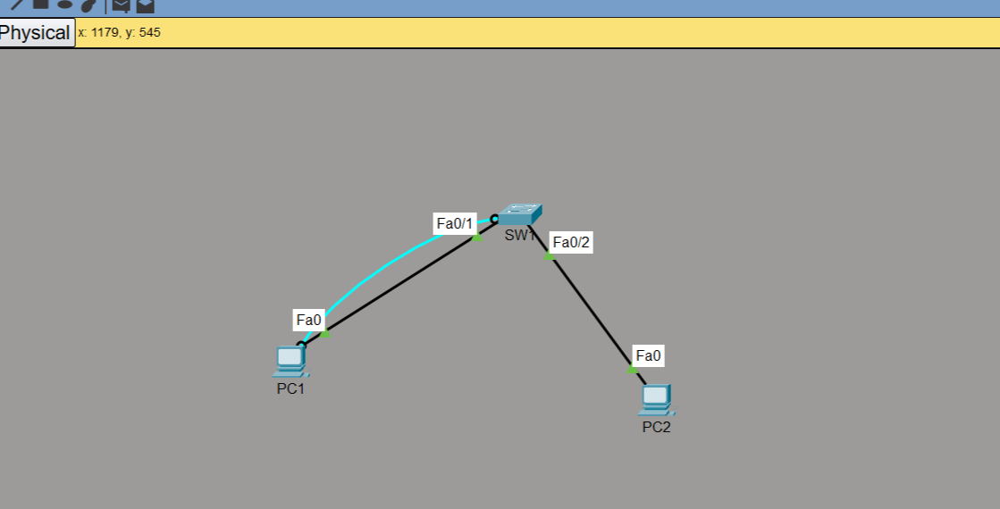
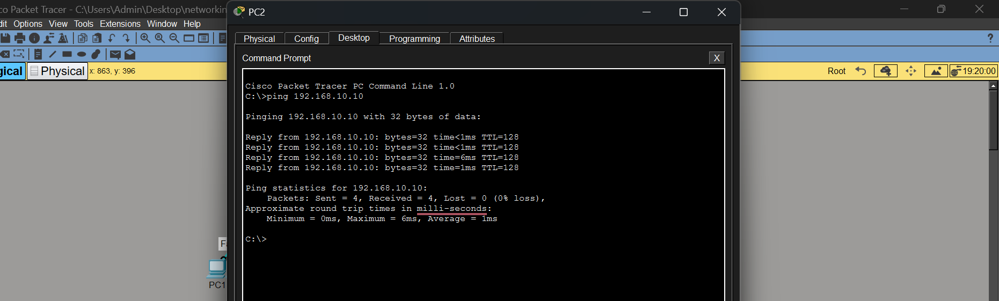
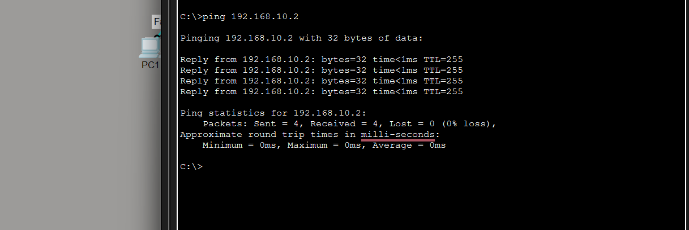
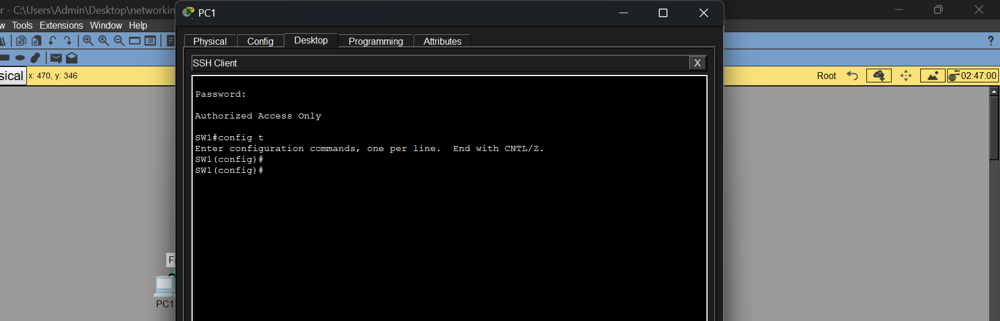

# Lab 01: Basic Switch Configuration and Hardening

## Purpose
Configure and secure a Cisco 2960 switch so that only authorised users can manage it, then verify connectivity between two PCs and the switch.

By the end of this lab the switch has:
- a management IP address on VLAN 1
- a protected privileged mode (`enable secret`)
- a password-protected console line
- secure remote management with **SSH version 2** and a local admin account (Telnet disabled)
- encrypted passwords in the configuration (`service password-encryption`)
- a warning banner shown at login

**Tool:** Cisco Packet Tracer

## Topology


PC1 is also connected to the switch console port with a rollover cable, which is used for the first configuration.

## IP Addressing Table

| Device | Interface | IP Address | Subnet Mask | Default Gateway |
|---|---|---|---|---|
| SW1 (Cisco 2960) | VLAN 1 (SVI) | 192.168.10.2 | 255.255.255.0 | not required (single subnet) |
| PC1 | FastEthernet0 | 192.168.10.10 | 255.255.255.0 | not required |
| PC2 | FastEthernet0 | 192.168.10.20 | 255.255.255.0 | not required |

## Cabling

| From | To | Cable |
|---|---|---|
| PC1 (FastEthernet0) | SW1 (Fa0/1) | Copper straight-through |
| PC2 (FastEthernet0) | SW1 (Fa0/2) | Copper straight-through |
| PC1 (RS 232) | SW1 (Console) | Console (rollover) |

## Lab Credentials (lab use only)

| Access | Username | Password |
|---|---|---|
| Privileged EXEC (`enable secret`) | n/a | `secret1234567` |
| Console line | n/a | `lab-console-1` |
| SSH remote login | `admin` | `cisco12345678` |

These passwords exist only for this Packet Tracer lab. Real devices need long, unique passwords.

## Configuration Summary
```
hostname SW1
service password-encryption
enable secret <password>

ip domain-name cisco-lab
username admin secret <password>
crypto key generate rsa modulus 2048
ip ssh version 2

interface vlan 1
 ip address 192.168.10.2 255.255.255.0
 no shutdown

banner motd #Authorized Access Only#

line console 0
 password <password>
 login

line vty 0 15
 login local
 transport input ssh
```
Full configuration (passwords redacted): [`configs/SW1.txt`](configs/SW1.txt)

## Verification

**1. PC1 to PC2** (connectivity between hosts)



**2. PC1 to the switch** (management IP reachable)



**3. Remote login over SSH** (`ssh -l admin 192.168.10.2` from PC1 shows the banner and asks for the password)



## What I learned
- Initial switch configuration from the console
- Securing console, privileged and remote access, and why `enable secret` is preferred over `enable password`
- Replacing Telnet with SSH: domain name, local user, RSA keys, `transport input ssh`
- Using an SVI as a management address on a layer 2 switch
- Verifying connectivity with ping and remote access with SSH

## Possible improvements
- Move management to a dedicated VLAN instead of VLAN 1
- Add `login block-for` to slow down password guessing
- Add port security on the access ports
