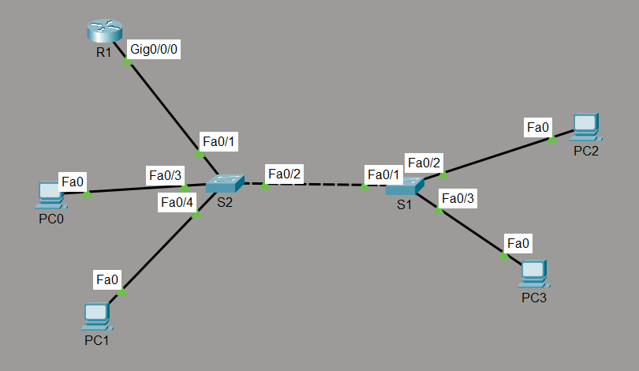
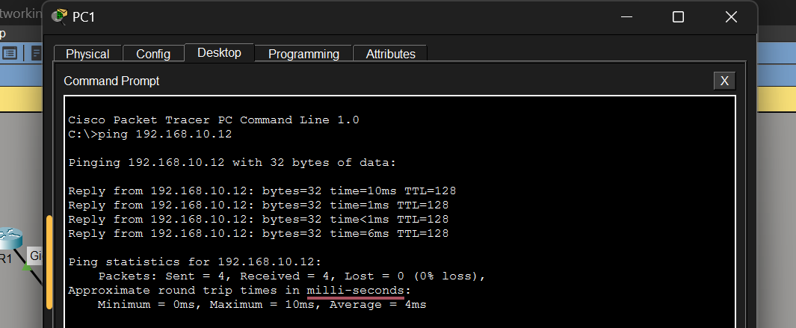
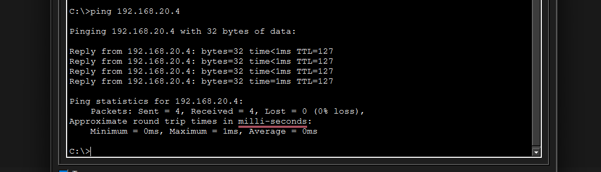
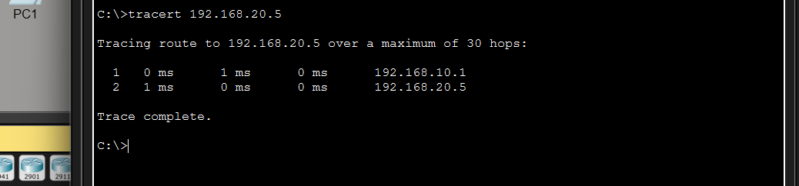
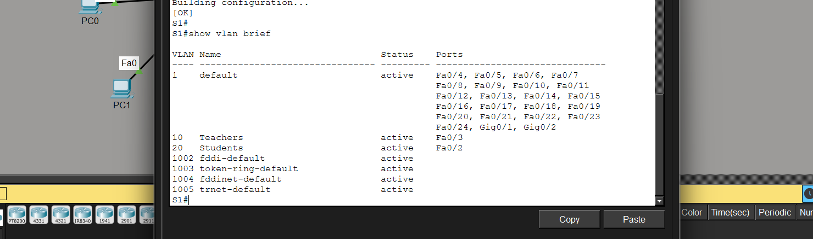
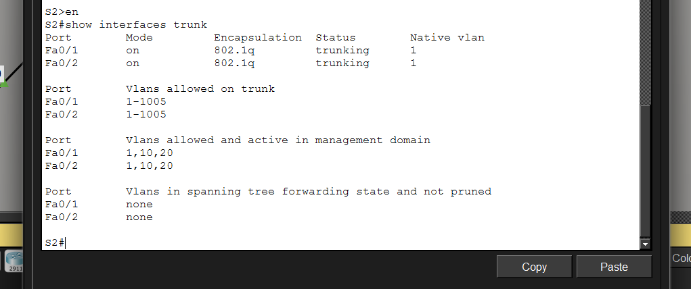

# Lab 02: Inter-VLAN Routing (Router-on-a-Stick)

## Purpose
Split a small network into two VLANs across two switches, then use a **single router link** (802.1Q trunk with subinterfaces) so that devices in different VLANs can communicate.

By the end of this lab:
- VLAN 10 (Teachers) and VLAN 20 (Students) exist on the switches, with PCs placed in the correct VLAN
- the two switches are joined by a trunk, and the router is joined to S2 by a trunk
- R1 has one subinterface per VLAN, acting as each VLAN's default gateway
- PCs in the same VLAN reach each other across both switches, and PCs in different VLANs reach each other through R1

**Tool:** Cisco Packet Tracer

## Topology


## Devices

| Device | Model | Role |
|---|---|---|
| R1 | Cisco ISR4331 | Router, inter-VLAN routing |
| S2 | Cisco 2960 | Switch connected to R1, S1, PC0 and PC1 |
| S1 | Cisco 2960 | Switch connected to S2, PC2 and PC3 |
| PC0 to PC3 | PC | End hosts |

## VLANs

| VLAN | Name | Network | Gateway (R1 subinterface) |
|---|---|---|---|
| 10 | Teachers | 192.168.10.0/24 | 192.168.10.1 (`Gi0/0/0.10`) |
| 20 | Students | 192.168.20.0/24 | 192.168.20.1 (`Gi0/0/0.20`) |

## IP Addressing Table

| Device | Interface | IP Address | Subnet Mask | Default Gateway |
|---|---|---|---|---|
| R1 | Gi0/0/0.10 | 192.168.10.1 | 255.255.255.0 | n/a |
| R1 | Gi0/0/0.20 | 192.168.20.1 | 255.255.255.0 | n/a |
| PC1 | FastEthernet0 | 192.168.10.11 | 255.255.255.0 | 192.168.10.1 |
| PC3 | FastEthernet0 | 192.168.10.12 | 255.255.255.0 | 192.168.10.1 |
| PC0 | FastEthernet0 | 192.168.20.4 | 255.255.255.0 | 192.168.20.1 |
| PC2 | FastEthernet0 | 192.168.20.5 | 255.255.255.0 | 192.168.20.1 |

## Switch Port Assignments

| Switch | Port | Mode | VLAN | Connected to |
|---|---|---|---|---|
| S2 | Fa0/1 | Trunk | all | R1 Gi0/0/0 |
| S2 | Fa0/2 | Trunk | all | S1 Fa0/1 (crossover cable) |
| S2 | Fa0/3 | Access | 20 | PC0 |
| S2 | Fa0/4 | Access | 10 | PC1 |
| S1 | Fa0/1 | Trunk | all | S2 Fa0/2 |
| S1 | Fa0/2 | Access | 20 | PC2 |
| S1 | Fa0/3 | Access | 10 | PC3 |

## Credentials
No device passwords are configured in this lab.

## Configuration Summary

**Switch S2** (S1 uses the same VLAN and trunk commands on its own ports)
```
vlan 10
 name Teachers
vlan 20
 name Students

interface fastEthernet 0/1
 switchport mode trunk
interface fastEthernet 0/2
 switchport mode trunk
interface fastEthernet 0/3
 switchport mode access
 switchport access vlan 20
interface fastEthernet 0/4
 switchport mode access
 switchport access vlan 10
```

**Router R1** (router-on-a-stick)
```
interface gigabitEthernet 0/0/0
 no shutdown
interface gigabitEthernet 0/0/0.10
 description default-gateway to VLAN 10
 encapsulation dot1Q 10
 ip address 192.168.10.1 255.255.255.0
interface gigabitEthernet 0/0/0.20
 description default-gateway to VLAN 20
 encapsulation dot1Q 20
 ip address 192.168.20.1 255.255.255.0
```
Full configurations: [`configs/R1.txt`](configs/R1.txt), [`configs/S1.txt`](configs/S1.txt), [`configs/S2.txt`](configs/S2.txt). VLAN names are stored in the switch VLAN database, so they appear in `show vlan brief` rather than in these files.

## Verification

**1. Same VLAN across both switches** (PC1 to PC3, both VLAN 10)



**2. Different VLANs through the router** (PC1 in VLAN 10 to PC0 in VLAN 20)



**3. Path through the router** (`tracert` from PC1 to PC2 shows the first hop is the VLAN 10 gateway, 192.168.10.1)



**4. VLANs on S1** (`show vlan brief`)



**5. Trunks on S2** (`show interfaces trunk`)



**6. Router subinterfaces** (`show ip interface brief` on R1)


The first ping between VLANs can show one timeout while ARP resolves; the following replies succeed.

## What I learned
- Creating and naming VLANs and assigning access ports
- Configuring 802.1Q trunks between switches and to a router
- Router-on-a-stick: one subinterface per VLAN, `encapsulation dot1Q <vlan>` before `ip address`
- Why traffic between VLANs needs a layer 3 device
- Verifying with ping, tracert, `show vlan brief` and `show interfaces trunk`

## Possible improvements
- Move unused ports into a shutdown "parking" VLAN
- Add a management IP on each switch and enable SSH (see Lab 01)
- Restrict the trunks with `switchport trunk allowed vlan 10,20`
- Add an ACL on R1 to control which VLAN can reach the other
