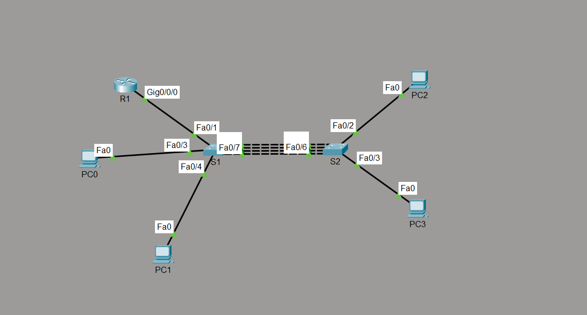
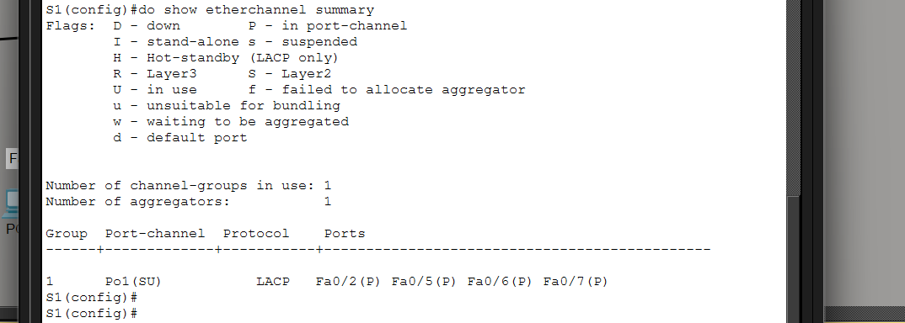
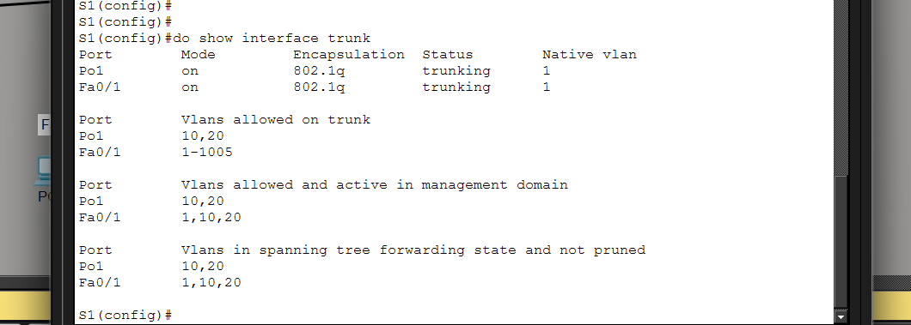
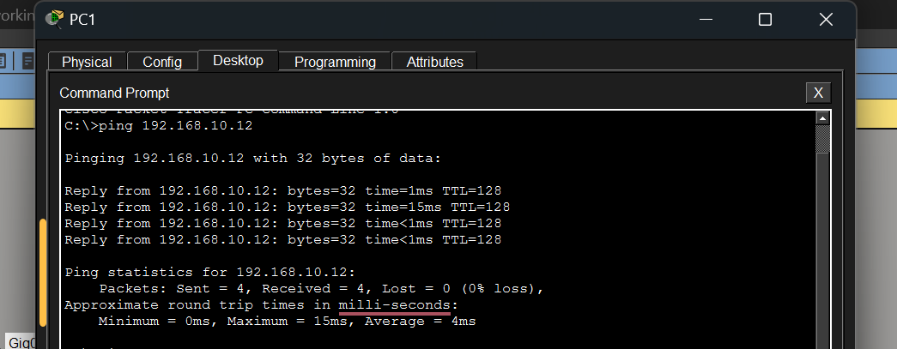
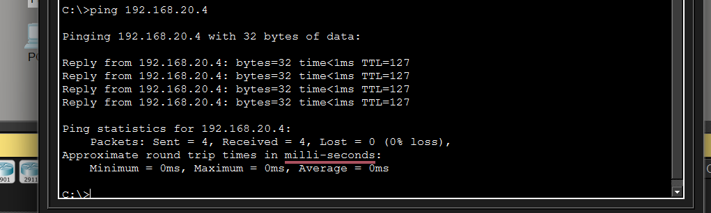
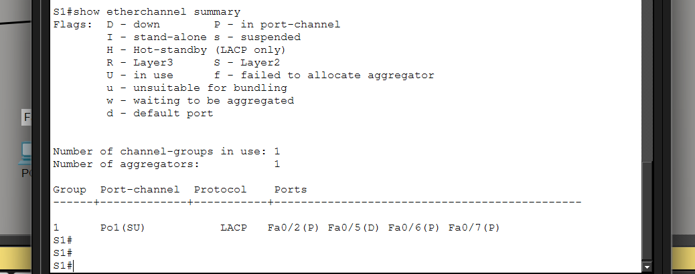
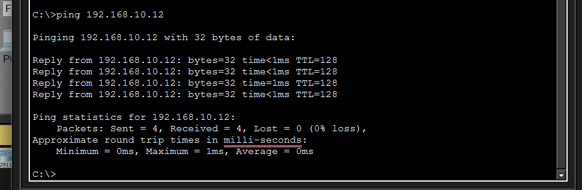

# Lab 03: Inter-VLAN Routing with EtherChannel

## Purpose
Extend the router-on-a-stick design from Lab 02 by joining the two switches with **four parallel links bundled into one logical link** (EtherChannel using LACP).

Without EtherChannel, Spanning Tree Protocol blocks all but one of the parallel links, so the extra cables carry nothing. With EtherChannel the four links act as one trunk, giving more bandwidth and keeping the connection up if a single cable fails.

By the end of this lab:
- VLAN 10 (Teachers) and VLAN 20 (Students) are carried across both switches
- four links between S1 and S2 form **Port-channel 1** (LACP: S1 `active`, S2 `passive`)
- the port-channel is a trunk allowing VLANs 10 and 20
- R1 routes between the VLANs using subinterfaces (router-on-a-stick)

**Tool:** Cisco Packet Tracer

## Topology


## Devices

| Device | Model | Role |
|---|---|---|
| R1 | Cisco ISR4331 | Router, inter-VLAN routing |
| S1 | Cisco 2960 | Switch connected to R1, S2 (EtherChannel), PC0 and PC1 |
| S2 | Cisco 2960 | Switch connected to S1 (EtherChannel), PC2 and PC3 |
| PC0 to PC3 | PC | End hosts |

## VLANs

| VLAN | Name | Network | Gateway (R1 subinterface) |
|---|---|---|---|
| 10 | Teachers | 192.168.10.0/24 | 192.168.10.1 (`Gi0/0/0.10`) |
| 20 | Students | 192.168.20.0/24 | 192.168.20.1 (`Gi0/0/0.20`) |

## IP Addressing Table

| Device | Interface | IP Address | Subnet Mask | Default Gateway |
|---|---|---|---|---|
| R1 | Gi0/0/0.10 | 192.168.10.1 | 255.255.255.0 | n/a |
| R1 | Gi0/0/0.20 | 192.168.20.1 | 255.255.255.0 | n/a |
| PC1 | FastEthernet0 | 192.168.10.11 | 255.255.255.0 | 192.168.10.1 |
| PC3 | FastEthernet0 | 192.168.10.12 | 255.255.255.0 | 192.168.10.1 |
| PC0 | FastEthernet0 | 192.168.20.4 | 255.255.255.0 | 192.168.20.1 |
| PC2 | FastEthernet0 | 192.168.20.5 | 255.255.255.0 | 192.168.20.1 |

## Switch Port Assignments

| Switch | Port | Mode | VLAN | Connected to |
|---|---|---|---|---|
| S1 | Fa0/1 | Trunk | all | R1 Gi0/0/0 |
| S1 | Fa0/2 | Port-channel 1 (LACP active) | trunk 10,20 | S2 Fa0/1 |
| S1 | Fa0/5 | Port-channel 1 (LACP active) | trunk 10,20 | S2 Fa0/4 |
| S1 | Fa0/6 | Port-channel 1 (LACP active) | trunk 10,20 | S2 Fa0/5 |
| S1 | Fa0/7 | Port-channel 1 (LACP active) | trunk 10,20 | S2 Fa0/6 |
| S1 | Fa0/3 | Access | 20 | PC0 |
| S1 | Fa0/4 | Access | 10 | PC1 |
| S2 | Fa0/1 | Port-channel 1 (LACP passive) | trunk 10,20 | S1 Fa0/2 |
| S2 | Fa0/4 | Port-channel 1 (LACP passive) | trunk 10,20 | S1 Fa0/5 |
| S2 | Fa0/5 | Port-channel 1 (LACP passive) | trunk 10,20 | S1 Fa0/6 |
| S2 | Fa0/6 | Port-channel 1 (LACP passive) | trunk 10,20 | S1 Fa0/7 |
| S2 | Fa0/2 | Access | 20 | PC2 |
| S2 | Fa0/3 | Access | 10 | PC3 |

## Credentials
No device passwords are configured in this lab.

## Configuration Summary

**VLANs** (on both switches)
```
vlan 10
 name Teachers
vlan 20
 name Students
```

**EtherChannel on S1** (LACP active)
```
interface range fastEthernet 0/2 , fastEthernet 0/5 - 7
 switchport mode trunk
 switchport trunk allowed vlan 10,20
 channel-group 1 mode active

interface port-channel 1
 switchport mode trunk
 switchport trunk allowed vlan 10,20
```

**EtherChannel on S2** (LACP passive)
```
interface range fastEthernet 0/1 , fastEthernet 0/4 - 6
 switchport mode trunk
 switchport trunk allowed vlan 10,20
 channel-group 1 mode passive

interface port-channel 1
 switchport mode trunk
 switchport trunk allowed vlan 10,20
```

**Router R1** (router-on-a-stick)
```
interface gigabitEthernet 0/0/0
 no shutdown
interface gigabitEthernet 0/0/0.10
 description default-gateway to VLAN 10
 encapsulation dot1Q 10
 ip address 192.168.10.1 255.255.255.0
interface gigabitEthernet 0/0/0.20
 description default-gateway to VLAN 20
 encapsulation dot1Q 20
 ip address 192.168.20.1 255.255.255.0
```
The access ports and the S1 trunk to R1 are configured as in [Lab 02](../02-inter-vlan-routing/). VLAN names are stored in the switch VLAN database, so they appear in `show vlan brief` rather than in the config files.
Full configurations: [`configs/R1.txt`](configs/R1.txt), [`configs/S1.txt`](configs/S1.txt), [`configs/S2.txt`](configs/S2.txt)

## Verification

**1. EtherChannel status** (`show etherchannel summary` on S1: the bundle is in use, `SU`, protocol LACP, with all four member ports bundled `P`)



**2. The port-channel is a trunk** (`show interfaces trunk` on S1)



**3. Same VLAN across the EtherChannel** (PC1 to PC3, both VLAN 10)



**4. Different VLANs through the router** (PC1 in VLAN 10 to PC0 in VLAN 20)



**5. Link failure test** (`Fa0/5` shut down: the bundle stays up as `Po1(SU)` with the other three ports bundled, and pings still succeed)





## What I learned
- Why parallel switch links need EtherChannel: STP would otherwise block them
- Configuring LACP (`active` on one side, `passive` on the other) and the port-channel interface
- Matching settings on every member port (mode, allowed VLANs), which LACP requires
- Verifying with `show etherchannel summary` and `show interfaces trunk`
- Testing redundancy by shutting down one member link

## Possible improvements
- Add a second router link or a third switch for a full redundant design
- Use `channel-group ... mode desirable` (PAgP) in a Cisco-only comparison lab
- Configure load balancing (`port-channel load-balance`) and compare results
